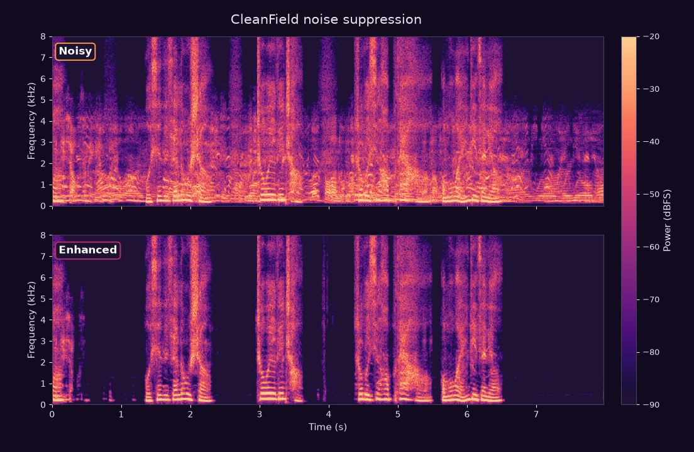
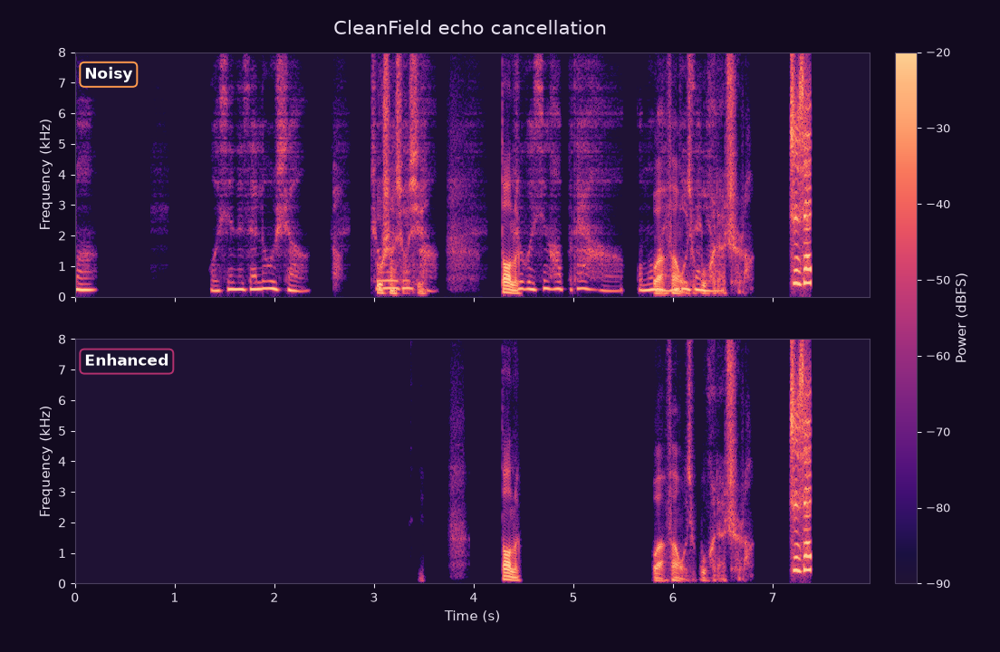

# CleanField

Neural speech enhancement for real-time audio: **noise suppression** and
**echo cancellation**, running as native code or WebAssembly.

**[Live demo](https://cleanfieldvoice.github.io/Cleanfield/web/)** · **[Before/after examples](https://cleanfieldvoice.github.io/Cleanfield/web/listen.html)**

- **Bit-exact models** — the neural graphs reproduce their reference outputs
  exactly, verified over 60 million intermediate values.
- **Fast** — 0.068 ms per frame with AVX2, 0.20 ms scalar, ~2–3 ms in the browser.
- **Allocation-free** — fixed-size workspaces; the steady state never allocates.
- **Portable** — one C ABI plus Node and browser bindings. No Rust toolchain
  needed to consume it.
- **Self-verifying** — a conformance pack proves an integration matches the
  reference frame for frame.

## Demo

[Live demo](https://cleanfieldvoice.github.io/Cleanfield/web/) · [Before/after examples](https://cleanfieldvoice.github.io/Cleanfield/web/listen.html)

Eleven before/after pairs, 8 s each, 16 kHz mono PCM16: five noise types in Chinese, five in English, plus one echo-cancellation pair. Use headphones.

Every clip is produced by this project: the speech is synthesised, the noise is generated from seeded sources at a measured SNR, and the "after" clip is the engine in this repository. The last column is the level drop in the pauses between sentences - where a noise suppressor has to act - while the speech itself moves by less than 0.2 dB.

**Noise suppression**

| Scenario | Before | After | Pause suppression |
| --- | --- | --- | --- |
| White noise, 12 dB SNR (Chinese) | [wav](assets/audio/denoise-zh-white-before.wav) | [wav](assets/audio/denoise-zh-white-after.wav) | −41.8 dB |
| Pink noise, 10 dB SNR (Chinese) | [wav](assets/audio/denoise-zh-pink-before.wav) | [wav](assets/audio/denoise-zh-pink-after.wav) | −41.6 dB |
| Babble, 9 dB SNR (Chinese) | [wav](assets/audio/denoise-zh-babble-before.wav) | [wav](assets/audio/denoise-zh-babble-after.wav) | −20.2 dB |
| Cafe, 8 dB SNR (Chinese) | [wav](assets/audio/denoise-zh-cafe-before.wav) | [wav](assets/audio/denoise-zh-cafe-after.wav) | −9.5 dB |
| Street, 11 dB SNR (Chinese) | [wav](assets/audio/denoise-zh-street-before.wav) | [wav](assets/audio/denoise-zh-street-after.wav) | −50.3 dB |
| White noise, 12 dB SNR (English) | [wav](assets/audio/denoise-en-white-before.wav) | [wav](assets/audio/denoise-en-white-after.wav) | −48.2 dB |
| Pink noise, 10 dB SNR (English) | [wav](assets/audio/denoise-en-pink-before.wav) | [wav](assets/audio/denoise-en-pink-after.wav) | −50.2 dB |
| Babble, 9 dB SNR (English) | [wav](assets/audio/denoise-en-babble-before.wav) | [wav](assets/audio/denoise-en-babble-after.wav) | −29.5 dB |
| Cafe, 8 dB SNR (English) | [wav](assets/audio/denoise-en-cafe-before.wav) | [wav](assets/audio/denoise-en-cafe-after.wav) | −7.2 dB |
| Street, 10 dB SNR (English) | [wav](assets/audio/denoise-en-street-before.wav) | [wav](assets/audio/denoise-en-street-after.wav) | −38.7 dB |

**Echo cancellation** (linear AEC + neural residual suppression)

The microphone hears the Chinese playback through a synthetic room impulse
response plus a gated near-end talker. After cancellation the echo-only
stretches drop by 56 dB and the near-end speech is within 0.8 dB.

| Scenario | Before | After | Echo suppression |
| --- | --- | --- | --- |
| Echo, near-end double talk (Chinese) | [wav](assets/audio/echo-zh-before.wav) | [wav](assets/audio/echo-zh-after.wav) | −56.3 dB |

Files are also in [`assets/audio/`](assets/audio) with the exact synthesis and
measurement record in the audio folder. The
demo speech was generated with a research/non-commercial text-to-speech model;
that restriction covers the demo audio only — the engine and its weights are
unaffected.

Spectrograms of the noise-suppression (Chinese babble) and echo scenes
(0–8 kHz, before / after):






## Models

| Model | Status | Layers | Input → output | Task |
| --- | --- | --- | --- | --- |
| **CleanField Voice** | stable | 19 | 513 → 1026 | Noise suppression on a 16 kHz log-power spectrum (0–8 kHz) |
| **CleanField Echo** | **alpha** | 89 | 3 × 513 → 513 | Residual echo suppression, given a linear residual, the microphone and the reference |

Both models run at 16 kHz, mono, on 16 ms hops and keep state across frames (one instance per stream). Their neural graphs are bit-exact against the reference implementation.

**Echo is alpha.** The model is bit-exact, but the path around it is young: the linear AEC is an independent implementation with no oracle, results are validated on synthetic scenes and 18 measured room impulses (17.6 dB mean clean, 6.5 dB worst) rather than real speaker-to-microphone hardware, and the browser demo ships noise suppression only. Expect its API and defaults to change.

**Linear AEC** (stage, not a model): partitioned-block frequency-domain adaptive filter, 2048 taps, zero allocations, ~0.2 ms per frame. Measured rooms score 4.1 dB below the synthetic grid, so treat synthetic numbers as an upper bound; see `crates/cf-aec/ROBUSTNESS.md`.

Latency: the AEC adds one 16 ms frame; the neural stage adds a 768-sample window plus 256 samples of look-ahead - 1280 samples (80 ms) in total.

## Performance

AMD Ryzen 5 5600, single thread, full model:

| Backend | ms / frame | fps | Multiple of real time (16 ms) |
| --- | ---: | ---: | ---: |
| Voice, AVX2 | 0.068 | 14 700 | 235× |
| Voice, scalar (FMA) | 0.200 | 5 000 | 80× |
| Voice, WebAssembly | ~2–3 | 330–480 | 5–8× |
| Echo, AVX2 | 0.49 | 2 040 | 32× |
| Linear AEC | 0.20 | 5 000 | 80× |

## Install

**C / C++**

```c
#include "cleanfield.h"

void *h = cf_voice_new(model_bytes, model_len);
cf_voice_process(h, frame_in, frame_out);   /* 513 in, 1026 out */
cf_voice_free(h);
```

Prebuilt libraries for Windows, macOS, Linux, Android, iOS and WebAssembly are
attached to each release with `cleanfield.h` and `SHA256SUMS`.

**Node**

```js
const { createVoice } = require("@cleanfield/node");
const denoiser = createVoice();
const mask = denoiser.process(frame);   // Float32Array(513) -> Float32Array(1026)
```

**Browser**

```js
import { attach } from "@cleanfield/web";
const { node, detach } = await attach(audioContext);
source.connect(node).connect(audioContext.destination);
```

**Rust**

```toml
[dependencies]
cf-voice = { path = "crates/cf-voice" }
cf-echo-pipeline = { path = "crates/cf-echo-pipeline" }   # AEC + echo model
```

## Verify an integration

```bash
python conformance/verify.py      # native library
node   conformance/verify.mjs     # wasm module
```

`RESULT: PASS` means every value of every frame matched bit for bit.

## Repository layout

```
crates/
  cf-core/            numeric primitives: FMA, reciprocal table, workspace, SIMD
  cf-voice/           19-layer noise-suppression graph
  cf-echo/            89-layer echo-cancellation graph
  cf-aec/             linear AEC (partitioned-block FDAF)
  cf-echo-pipeline/   AEC + echo model, end-to-end echo path
  cf-ffi/             C ABI (cdylib + staticlib)
  cf-wasm/            WebAssembly build with an embedded model
  cf-cli/             check / bench / dump / simd-check tooling
packages/
  node/               @cleanfield/node (N-API)
  web/                @cleanfield/web (wasm + AudioWorklet)
models/               .cfwm containers (voice, echo)
conformance/          bit-exactness vectors and verifiers
examples/             native embedding examples (C, Rust, Electron main process)
web/                  self-contained browser demo (live microphone + file mode)
assets/audio/         demo clips
include/              cleanfield.h
tools/                container builder, table generator, reference exporter
```

## Building

```bash
cargo build --release -p cf-ffi        # native library
cargo build --release --target wasm32-unknown-unknown -p cf-wasm
cargo test --workspace                 # includes a 10M-case FMA proof
```

> Build the native library with `-p cf-ffi`, not `--workspace`: a workspace build
> unifies the wasm crate's forced software-FMA feature into the core and makes
> every call site several times slower.

## Documentation

| Document | Contents |
| --- | --- |
| [CONTRACT.md](CONTRACT.md) | Frame-level API contract: rates, framing, state, latency, error codes, ABI policy |
| [NOTICE.template.md](NOTICE.template.md) | Notice fragment for applications that embed the engine |

## License

Engine code: MIT (see [LICENSE](LICENSE)). The model containers in `models/` are a separate
asset distributed with the engine for use with it; see [NOTICE.template.md](NOTICE.template.md).


